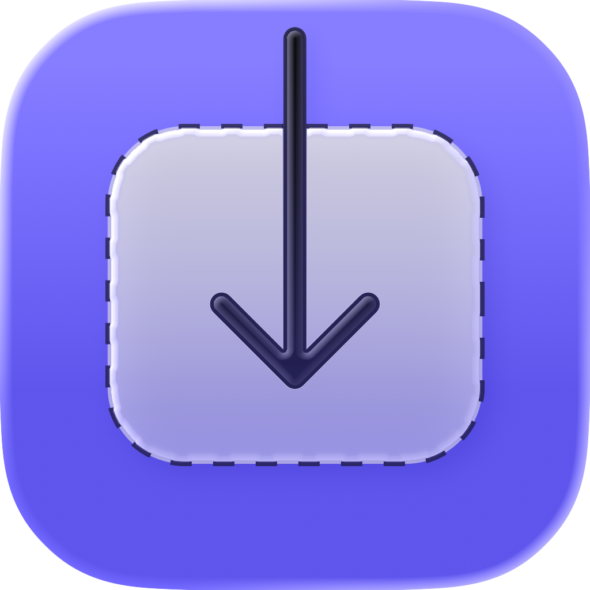
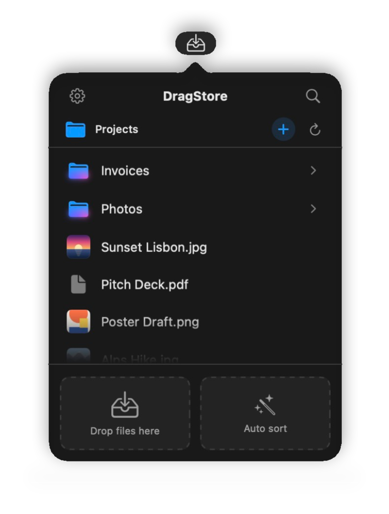
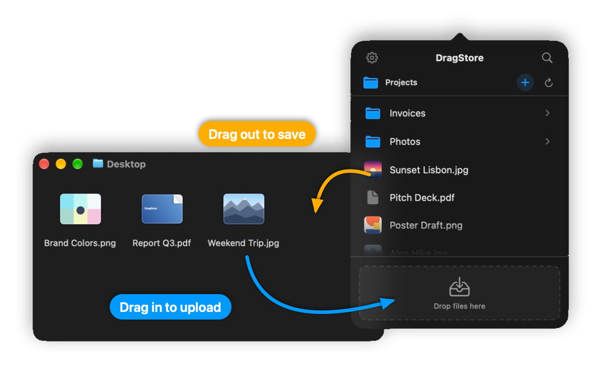
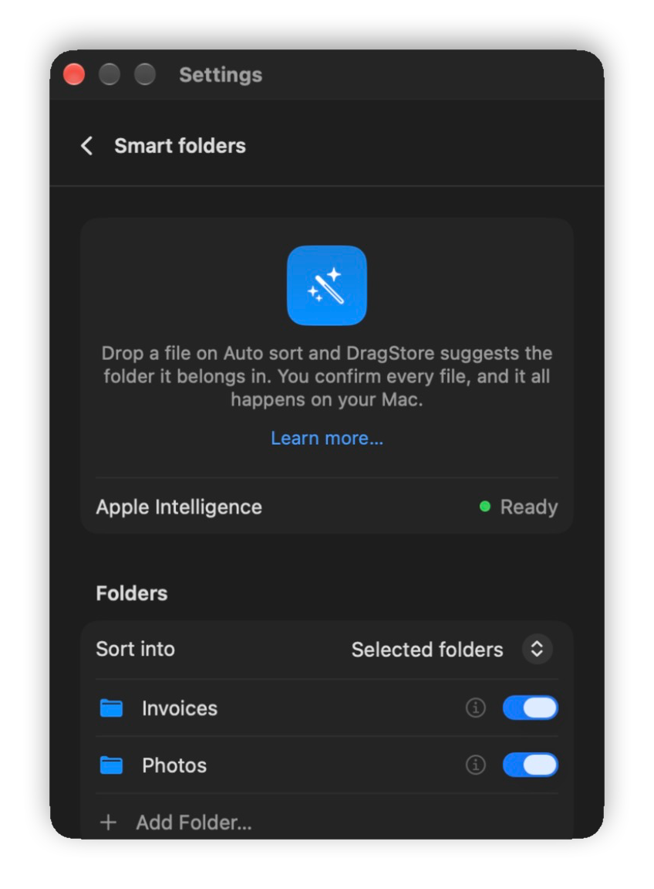
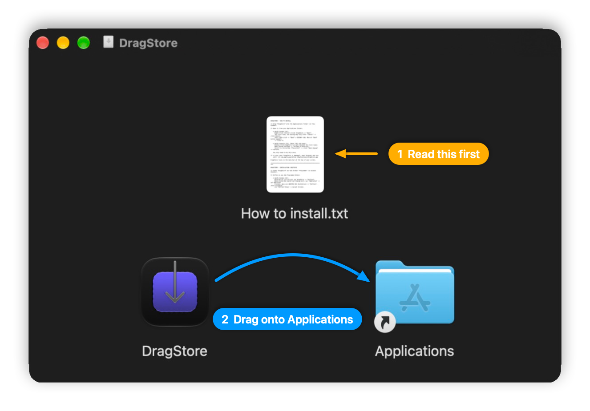

<p align="center">
  
</p>

<h1 align="center">DragStore</h1>

<p align="center">
  <b>Google Drive and your folders, one click away in the macOS menu bar.</b><br>
  Drag files in to upload them. Drag them out to save them. Free.
</p>

<p align="center">
  <a href="https://github.com/jstarndmprsn/dragstore-app/releases/download/v2.2.0/DragStore-2.2.0.dmg">
    
  </a>
</p>

<p align="center">
  <sub>Version 2.2.0 · macOS 14 Sonoma or later · Apple silicon and Intel ·
  <a href="https://github.com/jstarndmprsn/dragstore-app/releases">All releases</a></sub>
</p>

> [!IMPORTANT]
> **Please follow the instructions inside the DMG when you install.**
>
> DragStore is not from the App Store, so macOS blocks it the first time you open it. Open **"How to install.txt"** in the DMG: it shows the one-time steps for your macOS version. The same steps are also [below](#install).

<p align="center">
  
</p>

## How it works

DragStore lives in the menu bar. Click its icon (or press your keyboard shortcut) and your files are right there, without opening a browser or a Finder window.

- **Drag in** files or whole folders from Finder or your desktop, and they are uploaded to the folder you are looking at.
- **Drag out** a file into Finder, onto your desktop or into another app, and it is saved right there.

<p align="center">
  
</p>

## Features

- **Google Drive or a local folder.** Use your Google Drive, a folder on your Mac, or both, and switch in one click. The local folder works without any account.
- **Works like the Finder.** Click to select, double-click to open, hold a file over a folder to spring it open, ⌘C / ⌘X / ⌘V, move, rename, duplicate, Quick Look preview, search and sorting.
- **Uploads you stay in control of.** Progress shows under the menu-bar icon, every upload can be cancelled, and for duplicates you choose *Replace* or *Keep both*.
- **Share from the menu bar.** Change who can see a Drive file or folder without opening the browser.
- **Smart Folders\*.** Drop a file on *Auto sort* and DragStore suggests the folder it belongs in (see below).
- **Shortcuts, Siri and Spotlight.** Actions to open DragStore, upload files and auto-sort files\*.
- **Hands-on setup.** A short tutorial with sample files shows you everything. Nothing real is touched.
- **Make it yours.** Eight accent colours, a global keyboard shortcut, launch at login, English and German.
- **Automatic updates.** DragStore tells you when a new version is ready.

## Smart Folders\*



Pick the folders you want DragStore to sort into. When you drop a file on **Auto sort**, DragStore reads a little of it (text, PDF text, or what is in a picture) and suggests the best folder. You confirm every file.

- Runs **on your Mac** with Apple Intelligence. No file content leaves your Mac.
- Knows file types: photos, spreadsheets, audio, code, installers and more go where they belong.
- Suggests a **new folder** when nothing fits.
- Can learn which folders you use for which file types (optional, can be reset).

<br clear="right">

\* *requires macOS 26 or later and a Mac with an Apple Chip*

## Install

<p align="center">
  
</p>

1. **Download** the DMG with the button at the top and open it.
2. **Read "How to install.txt"** in the DMG window.
3. **Drag DragStore onto the Applications folder.**
4. **Open DragStore once from your Applications folder.** macOS blocks it the first time, because it is not from the App Store. You only have to do this once:
   - **macOS 15 Sequoia, 26 Tahoe and newer:** double-click DragStore (it gets blocked). Then open **System Settings → Privacy & Security**, scroll down to **Security**, click **Open Anyway** and confirm.
   - **macOS 14 Sonoma:** right-click (or Control-click) DragStore → **Open**. If the dialog only offers *Cancel*, click *Cancel* and right-click → **Open** a second time. Now an **Open** button appears.
5. DragStore appears in the **menu bar** at the top of your screen and walks you through the setup.

<details>
<summary>macOS says "DragStore is damaged and can't be opened"</summary>

This is the same block as above, shown in a different way. Open the **Terminal** app and run:

```bash
xattr -dr com.apple.quarantine /Applications/DragStore.app
```

Then open DragStore again.
</details>

## Privacy

- **No servers.** DragStore talks directly to Google. There is no DragStore server and no tracking.
- **Only the files you choose.** DragStore uses Google's per-file Drive access (`drive.file`): it can only see files you add with the Google file picker or that you upload with DragStore. The rest of your Drive stays private.
- **Stays on your Mac.** Your sign-in, settings and temporary files are stored only on your Mac. Temporary files are deleted automatically.

Read the full [Privacy Policy](https://jstarndmprsn.github.io/dragstore-app/) and the [Terms of Service](https://jstarndmprsn.github.io/dragstore-app/terms.html).

## Questions or problems?

Write to **dragstore.app@gmx.de**.
